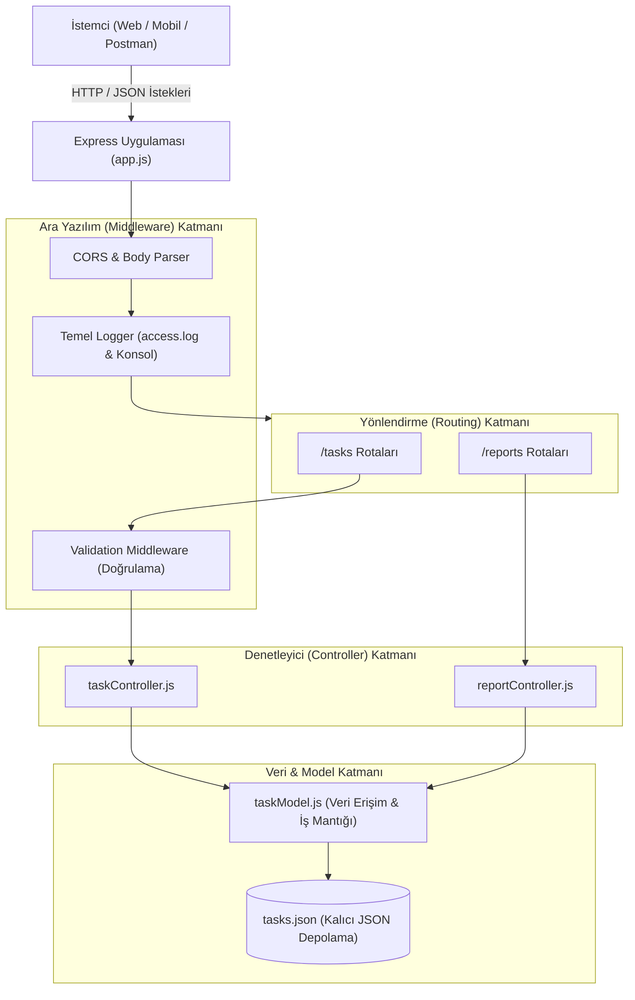

#  TASKFLOW: Görev ve Proje Yönetim Sistemi API — Proje Tanıtım Dokümanı

**Eğitim:** Node.js ile Backend Programlama — Bitirme Projesi  
**Dönem:** 2026  
**Geliştirici:** ertandev  
**Proje Adı:** TASKFLOW REST API  
**Mimari:** Katmanlı RESTful Mimari (MVC Tabanlı Express.js)  

---

##  1. Projenin Amacı

Bu projenin temel amacı, modern yazılım ekiplerinin proje ve görev süreçlerini merkezi, ölçeklenebilir ve güvenilir bir biçimde yönetebilmelerini sağlayacak bir **RESTful API** arka uç (backend) sistemi geliştirmektir.

Katılımcının eğitim süresince edindiği:
-  Node.js çalışma ortamı ve asenkron programlama,
-  Express.js ile sunucu ve modüler yönlendirme (routing) mimarisi,
-  Katmanlı mimari (Controller, Model/Service, Middleware),
-  REST mimari prensiplerine uygun CRUD operasyonları,
-  Ara yazılım (Middleware) geliştirme ve zincirleme mekanizmaları,
-  Veri yönetimi, dosya tabanlı JSON veri depolama ve CRUD işlemleri,
-  Gelişmiş veri sorgulama (filtreleme, arama, sayfalama ve sıralama),
-  Hata yönetimi ve veri doğrulama (validation),
-  İstatistiksel özetleme ve raporlama servisleri

yetkinliklerini endüstri standartlarında uygulamalı olarak somutlaştırmaktadır.

---

##  2. Proje Senaryosu ve İş İhtiyaçları

### 2.1 Şirket Senaryosu
Orta ve büyük ölçekli bir yazılım geliştirme şirketi; birden fazla departmandan (Frontend, Backend, Mobil, DevOps, QA, UI/UX) oluşan ekiplerinin yürüttüğü projeleri, projelere ait görevleri ve çalışanların bireysel sorumluluklarını tek bir panel üzerinden izlemek istemektedir.

### 2.2 Çözülen Problemler ve Sistem Sorumlulukları
1. **Görev Oluşturma ve Dağıtımı:** Proje yöneticileri ve takım liderleri sistem üzerinden yeni görevler oluşturabilmeli, bunları ilgili çalışanlara atayabilmeli ve öncelik derecelerini belirleyebilmelidir.
2. **Durum Takibi:** Çalışanlar üzerlerine atanan görevlerin durumlarını anlık olarak (`pending`, `in_progress`, `completed`) güncelleyebilmelidir.
3. **Öncelik Yönetimi:** Kritik işler (`critical`, `high`) ile standart işler (`medium`, `low`) birbirinden ayrıştırılarak sprint planlamaları optimize edilmelidir.
4. **Hızlı Arama ve Filtreleme:** Yüzlerce görev içerisinden duruma göre, önceliğe göre veya çalışan bazında hızlı filtreleme yapılabilmeli, anahtar kelimelerle anında arama yapılabilmelidir.
5. **Yönetimsel Raporlama:** Yönetim kadrosu, tamamlanan işlerin sayısını, bekleyen görev yükünü ve departman genelindeki görev dağılım istatistiklerini tek bir API çağrısı ile raporlayabilmelidir.

---

##  3. Sistem Mimarisi ve Tasarım Prensipleri

Sistem, bakım yapılabilirliği (maintainability) ve genişletilebilirliği (extensibility) en üst seviyede tutacak şekilde **Katmanlı Mimari (Layered Architecture)** prensibine göre tasarlanmıştır:

---

##  4. Temel Özellikler Özeti

| Kategori | Özellik | Açıklama |
|---|---|---|
| **CRUD** | Görev Ekleme | Başlık, açıklama, öncelik ve atanan kişi bilgisiyle yeni görev oluşturma (`POST /tasks`) |
| **CRUD** | Görev Listeleme | Tüm görevlerin listelenmesi (`GET /tasks`) |
| **CRUD** | Görev Detayı | Belirli bir ID'ye sahip görevin tekil sorgulanması (`GET /tasks/:id`) |
| **CRUD** | Görev Güncelleme | Görev durumu, önceliği veya açıklamasının revize edilmesi (`PUT /tasks/:id`) |
| **CRUD** | Görev Silme | Tamamlanan veya iptal edilen görevin silinmesi (`DELETE /tasks/:id`) |
| **Middleware** | Logger | Her isteğin zaman damgası, endpoint ve metot bilgisiyle loglanması |
| **İleri Pratik 1** | Filtreleme & Arama | `status`, `priority`, `keyword`, `assignee` sorgu parametreleriyle filtreleme |
| **İleri Pratik 1** | Sayfalama & Sıralama | `page`, `limit`, `sort`, `order` ile performanslı sayfalama |
| **İleri Pratik 2** | Validation Middleware | Görev ekleme ve güncellemelerde katı doğrulama kuralları (400 Bad Request) |
| **İleri Pratik 3** | Raporlama Servisleri | Tamamlanan (`/reports/completed`), bekleyen (`/reports/pending`) ve genel özet (`/reports/summary`) |
| **İleri Pratik 4** | Kapsamlı Dokümantasyon | API dokümantasyonu, test dokümantasyonu, kullanım kılavuzu ve Postman koleksiyonu |

---

##  5. Değerlendirme Kriterleri Uyumluluk Matrisi

| Kriter | Puan | Karşılanma Durumu | Kanıt / Dosya |
|---|---|---|---|
| **CRUD İşlemleri** | 30 | Eksiksiz ve test edildi | `src/controllers/taskController.js`, `src/routes/taskRoutes.js` |
| **Routing Yapısı** | 15 | Modüler Express Router | `src/routes/index.js`, `src/routes/taskRoutes.js`, `src/routes/reportRoutes.js` |
| **Temel Middleware (Logger)** | 15 | Konsol ve Dosya Loglaması | `src/middlewares/loggerMiddleware.js`, `logs/access.log` |
| **Kod Kalitesi** | 15 | Clean Code, Modüler Mimari | Kod standartları, hata yakalama, açıklayıcı JSDoc yorumları |
| **Dokümantasyon (Temel)** | 15 | Kapsamlı Doküman Seti | `README.md`, `docs/PROJE_TANIMI.md`, `docs/VERI_MODELI.md` |
| **Test Süreçleri (Postman)** | 10 | 52/52 Başarılı Test & Görseller | `postman/TaskFlow_API.postman_collection.json`, `docs/screenshots/` |
| **TOPLAM** | **100 / 100** | **Tam Puan Hedefi Başarıyla Sağlandı** | Tüm zorunlu ve isteğe bağlı maddeler tamamlandı. |
