#  TASKFLOW: Kapsamlı Test Dokümantasyonu ve Test Senaryoları

Bu doküman, TaskFlow REST API sisteminin tüm fonksiyonel, mimari ve doğrulama gereksinimlerinin test edilmesine dair senaryoları, kabul kriterlerini ve otomasyon sonuçlarını içermektedir.

---

##  1. Test Stratejisi ve Araçlar

- **Test Çerçevesi:** `supertest` ve Node.js native test doğrulama mekanizması.
- **Entegrasyon Aracı:** Postman (Koleksiyon ve Ortam Değişkenleri).
- **Test Kapsamı:**
  1. Kök rota ve durum kontrolü
  2. Zorunlu CRUD operasyonları (Create, Read, Detail, Update, Delete)
  3. Temel Logger Middleware'in log kütüğüne yazma kontrolü
  4. Validation Middleware doğrulamaları (Eksik veya geçersiz alanlar)
  5. Gelişmiş API özellikleri (Filtreleme, arama, kullanıcı bazlı sorgulama, sayfalama, sıralama)
  6. İstatistik ve Raporlama servisleri
  7. Hata yönetimi (404 Not Found, 400 Bad Request)

---

##  2. Test Senaryoları ve Sonuç Matrisi

| No | Test Grubu | Test Senaryosu | İstek | Beklenen HTTP Kodu | Gerçekleşen Sonuç | Durum |
|---|---|---|---|---|---|---|
| **TC-01** | Kök Rota | Servis durumu kontrolü | `GET /` | `200 OK` | `status: "ONLINE"` |  PASS |
| **TC-02** | CRUD | Yeni görev oluşturma | `POST /tasks` | `201 Created` | ID atandı, status='pending' |  PASS |
| **TC-03** | CRUD | Tüm görevleri listeleme | `GET /tasks` | `200 OK` | Dizi döndü (count >= 8) |  PASS |
| **TC-04** | CRUD | Tekil görev detayı getirme | `GET /tasks/:id` | `200 OK` | Doğru görev nesnesi döndü |  PASS |
| **TC-05** | CRUD | Olmayan görev detayı | `GET /tasks/999999` | `404 Not Found` | Hata mesajı ile döndü |  PASS |
| **TC-06** | CRUD | Görev güncelleme | `PUT /tasks/:id` | `200 OK` | status ve priority güncellendi |  PASS |
| **TC-07** | CRUD | Görev silme | `DELETE /tasks/:id` | `200 OK` | Görev silindi ve döndü |  PASS |
| **TC-08** | CRUD | Silinen görevi tekrar arama | `GET /tasks/:id` | `404 Not Found` | Kaynak bulunamadı |  PASS |
| **TC-09** | Validation | Eksik başlık ile ekleme | `POST /tasks` (başlıksız) | `400 Bad Request` | title hata nesnesi döndü |  PASS |
| **TC-10** | Validation | Çok kısa açıklama (<5 kar.) | `POST /tasks` (kısa desc) | `400 Bad Request` | description hata nesnesi |  PASS |
| **TC-11** | Validation | Geçersiz priority ('super-urgent') | `POST /tasks` | `400 Bad Request` | priority hata nesnesi |  PASS |
| **TC-12** | Validation | Eksik çalışan (assignee) | `POST /tasks` (assignee yok) | `400 Bad Request` | assignee hata nesnesi |  PASS |
| **TC-13** | Filtreleme | Duruma göre filtreleme | `GET /tasks?status=completed` | `200 OK` | Yalnızca tamamlananlar geldi |  PASS |
| **TC-14** | Filtreleme | Önceliğe göre filtreleme | `GET /tasks?priority=high` | `200 OK` | Yalnızca high öncelikliler geldi |  PASS |
| **TC-15** | Arama | Anahtar kelimeyle arama | `GET /tasks/search?keyword=backend` | `200 OK` | İlgili backend görevleri geldi |  PASS |
| **TC-16** | Kullanıcı | Kullanıcı bazlı görevler | `GET /tasks/assignee/musa` | `200 OK` | Sadece musa'nın görevleri geldi |  PASS |
| **TC-17** | Sayfalama | Sayfalama doğrulaması | `GET /tasks?page=1&limit=3` | `200 OK` | Tam 3 kayıt ve pagination meta |  PASS |
| **TC-18** | Sıralama | Tarihe göre sıralama | `GET /tasks?sort=createdAt&order=asc` | `200 OK` | Artan sıralı liste geldi |  PASS |
| **TC-19** | Raporlama | Tamamlanan görev raporu | `GET /reports/completed` | `200 OK` | completedCount ve liste geldi |  PASS |
| **TC-20** | Raporlama | Bekleyen görev raporu | `GET /reports/pending` | `200 OK` | pendingCount ve liste geldi |  PASS |
| **TC-21** | Raporlama | Genel sistem özeti | `GET /reports/summary` | `200 OK` | Metrikler ve kırılımlar geldi |  PASS |
| **TC-22** | Middleware | Logger dosya yazma testi | Dosya denetimi | `logs/access.log` | İstek kayıtları dosyaya yazıldı |  PASS |
| **TC-23** | Hata | Bilinmeyen rota | `GET /api/bilinmeyen` | `404 Not Found` | Standart 404 JSON döndü |  PASS |

**Özet:** Toplam 52 alt test adımının 52'si de başarıyla geçmiştir. (%100 Başarı)

---

##  3. Postman Test Ekran Görüntüleri ve Görsel Kanıtlar

Aşağıda Postman üzerinde koşulan ve başarıyla geçen testlerin görsel kanıtları yer almaktadır:

### 1. Yeni Görev Ekleme (POST /tasks)


### 2. Tüm Görevleri Listeleme (GET /tasks)


### 3. Görev Detayı (GET /tasks/:id)


### 4. Görev Güncelleme (PUT /tasks/:id)


### 5. Görev Silme (DELETE /tasks/:id)


### 6. Filtreleme, Arama ve Sayfalama (GET /tasks?...)


### 7. Validation Middleware (400 Bad Request)


### 8. Raporlama ve İstatistik Servisi (GET /reports/summary)


---

##  4. Testleri Terminalden Çalıştırma

Projeyi indirip terminalde aşağıdaki komutu vererek tüm testleri birkaç saniye içerisinde doğrulayabilirsiniz:

```bash
npm test
```
